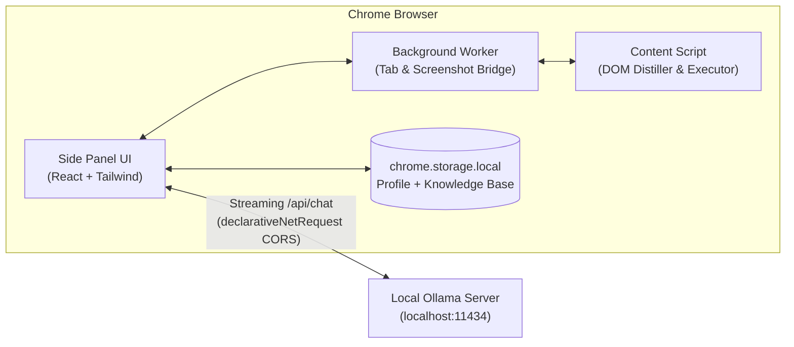

# Any Agent — 100% Local Browser AI Agent for Chrome

**Any Agent** is a privacy-first Chrome Side Panel AI assistant and autonomous browser agent powered 100% locally by **Ollama** (`deepseek-r1:8b`, `gemma4`, `llama3.2-vision`, `qwen2.5vl`, etc.).

It reads and summarizes webpages, fills out complex forms using your local personal memory, captures scrolled multi-page screenshots when DOM text is unavailable, and continuously learns durable facts about you—with **zero cloud APIs, zero subscriptions, and zero data leaving your machine**.

---

## Key Features

### 1. Persistent Personal Memory & Cross-AI Knowledge Import
- **Structured Profile Storage:** Store your contact info, social links (GitHub, LinkedIn, X/Twitter, Portfolio), education, skills, bio, and project summaries in `chrome.storage.local`.
- **Bring Your Context from Other AIs:** Includes a built-in export prompt and local TF-IDF retrieval engine (`src/lib/knowledge.ts`) so you can paste your personal context from other AI assistants, automatically extract profile fields, and inject only the most relevant excerpts into each prompt.
- **Continuous Learning from Chat:** Whenever you mention something new about yourself in conversation, Any Agent extracts and saves the new fact or profile update in the background—complete with a one-click **Undo** button.

### 2. Lightweight DOM Distillation Engineered for 8B Local Models
- Small local models (`8B`–`12B`) struggle with raw HTML dumps. Any Agent's content script (`src/content/index.ts`) distills the active page into a compact, token-efficient representation:
  - Prioritizes interactive form controls (`<input>`, `<textarea>`, `<select>`) before buttons and links.
  - Resolves human-readable field labels across complex layouts (`aria-label`, `<label for>`, ancestor input-groups, `@` handle prefixes, and humanized `name`/`id` attributes).
  - Extracts clean, deduplicated article and page text (`<main>`, `<article>`, headings, lists, and user-highlighted text).

### 3. Multi-Step Autonomous Browser Loop (`Observe → Think → Act`)
- **React / Vue / Angular Safe Execution:** Uses native `HTMLInputElement.prototype.value` setters and dispatches synthetic `InputEvent`, `change`, and `keyup` events so modern controlled forms update their state reliably.
- **Self-Healing Target Matcher:** If a small local model guesses the wrong element ID, Any Agent automatically matches the intended `<input>` or `<textarea>` using label/context hints and normalizes values (such as stripping `https://x.com/` down to the `@` handle when a username field is detected).
- **Safe Submit Protection:** Fills all fields and highlights them visually, but automatically pauses right before clicking final `Submit` / `Apply` buttons so you can review everything first.

### 4. Multi-Screenshot Visual Fallback (Vision Mode)
- When a page has sparse or inaccessible DOM text (PDFs, canvas apps, or restricted views)—or when you ask for a visual scan—Any Agent automatically scrolls through the page, captures multiple viewport screenshots (`chrome.tabs.captureVisibleTab`), and passes them to your local vision model.

### 5. Built for Reasoning & Instruct Models Alike
- **Live `<think>` Streaming:** First-class support for reasoning models like `deepseek-r1:8b` with a live-streaming, auto-collapsing thought process drawer.
- **Highlight-to-Reply in Chat:** Highlight any snippet inside the side panel chat to pop up a floating **Reply | Copy** toolbar for targeted follow-ups.
- **Zero-Config Ollama CORS:** Uses Chrome's `declarativeNetRequest` (`public/rules.json`) to rewrite request headers to `localhost:11434` automatically—no terminal `OLLAMA_ORIGINS=*` workarounds required.

---

## System Architecture



---

## Getting Started

### 1. Prerequisites
1. Install and run **[Ollama](https://ollama.com/)** locally (`http://localhost:11434`).
2. Pull at least one local model (and optionally a vision model for screenshot fallback):
   ```bash
   ollama pull deepseek-r1:8b
   ollama pull gemma4:12b
   ```

### 2. Install & Build the Extension
```bash
# Clone the repository
git clone https://github.com/YADUNANDAN-SINGH/any-agent.git
cd any-agent

# Install dependencies
npm install

# Build production extension into dist/
npm run build
```

For live rebuilds while developing:
```bash
npm run dev
```

### 3. Load Unpacked in Chrome
1. Open Google Chrome and navigate to `chrome://extensions/`.
2. Enable **Developer mode** (toggle in the top-right corner).
3. Click **Load unpacked** and select the **`dist`** folder inside this project.
4. Click the **Any Agent** icon in your Chrome toolbar to open the Side Panel.

---

## Project Structure

```text
any-agent/
├── public/
│   ├── manifest.json              # Manifest V3 config (sidePanel, scripting, storage)
│   └── rules.json                 # declarativeNetRequest rules for zero-config Ollama CORS
├── src/
│   ├── background/
│   │   └── index.ts               # Service worker: content script injection & tab screenshots
│   ├── content/
│   │   └── index.ts               # DOM distiller, label resolver, & React-safe action executor
│   ├── components/
│   │   ├── KnowledgePanel.tsx     # Cross-AI context importer & knowledge manager
│   │   ├── MarkdownRenderer.tsx   # Streaming-safe Markdown renderer
│   │   ├── MemoryPanel.tsx        # Structured personal profile editor
│   │   ├── SettingsPanel.tsx      # Model selector, vision config, & loop safety controls
│   │   └── StepTraceCard.tsx      # Live reasoning (<think>) & action execution trace card
│   ├── lib/
│   │   ├── browserBridge.ts       # Messaging bridge + scrolled multi-screenshot capture
│   │   ├── knowledge.ts           # Chunking, TF-IDF retrieval, & chat memory helpers
│   │   ├── ollama.ts              # Ollama streaming client, prompt builder, & memory extractor
│   │   └── storage.ts             # chrome.storage.local persistence layer
│   ├── types/
│   │   └── agent.ts               # TypeScript interfaces
│   ├── App.tsx                    # Main Side Panel controller & multi-step agent loop
│   └── main.tsx                   # React entry point
├── package.json
├── tailwind.config.js
├── tsconfig.json
└── vite.config.ts
```

---

## Privacy & Security
- **100% Local Execution:** All prompts, webpage snapshots, screenshots, and personal profile data stay between your Chrome browser and your local `localhost:11434` Ollama instance.
- **Safe Submit Mode:** Enabled by default so the agent never submits a form or application without your final review.

---

## License
MIT

