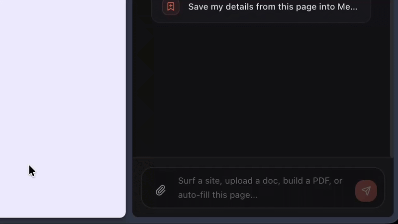
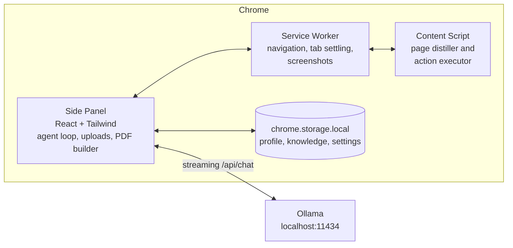

<div align="center">

# Any Agent

**A private AI agent for Chrome that runs entirely on your own machine.**

Reads pages, surfs the web, fills forms, understands your documents and builds PDFs,
all powered by a local [Ollama](https://ollama.com/) model. No cloud, no API keys, no subscription.


-000000)


<br />



</div>

---

## Contents

- [Demo](#any-agent)
- [Why Any Agent](#why-any-agent)
- [What it can do](#what-it-can-do)
- [Quick start](#quick-start)
- [Example prompts](#example-prompts)
- [Supported uploads](#supported-uploads)
- [Settings](#settings)
- [How it works](#how-it-works)
- [Project structure](#project-structure)
- [Development](#development)
- [Troubleshooting](#troubleshooting)
- [Privacy and safety](#privacy-and-safety)
- [Known limitations](#known-limitations)
- [License](#license)

---

## Why Any Agent

Most browser AI assistants send every page you read, and everything you know about yourself, to a remote server. Any Agent keeps all of it local. It opens in Chrome's side panel and sends your prompts, page content, screenshots, documents and personal profile only to the Ollama server on your own computer.

It is tuned for **small local models (8B to 12B parameters)**. Pages are condensed into a compact, labelled summary instead of raw HTML. Every step is short and focused. When a model makes a mistake, such as picking the wrong field or returning slightly broken JSON, the agent corrects it instead of failing.

---

## What it can do

### Understand any webpage
- Summarizes articles, documentation, product pages and anything else you have open.
- Text you highlight on the page gets extra attention.
- **Vision fallback:** when a page has little readable text (canvas apps, PDF viewers, image-heavy pages), or when you ask for a visual look, it scrolls through the page and passes a series of screenshots to your local vision model.

### Surf the web for you
- Runs web searches (Google, DuckDuckGo or Bing), opens results by number, visits URLs or plain domains like `github.com`, follows links and goes back.
- Works step by step (**Observe, Think, Act**) and keeps notes from every page it visits, so the final answer draws on all of them.
- Stops and hands control back to you if a site shows a CAPTCHA or human-verification check. It never tries to get past one.

### Work with your documents
- Attach files with the paperclip button or by dragging them onto the chat box.
- Reads PDF, Word, PowerPoint, Markdown, CSV, JSON, code and images. Scanned PDFs are turned into page images for your vision model.
- Attached documents stay available for follow-up questions in the same conversation.

### Build PDFs on request
- Ask for a report, summary, résumé, comparison or guide **as a PDF**. The agent gathers the material (from the page, your documents or the web), writes the document, and downloads a clean multi-page PDF.
- The PDF includes headings, bold and code text, nested lists, aligned tables, block quotes and page numbers.
- Preview any generated PDF in a new tab, or turn any long answer into a PDF with **Export as PDF**.

### Fill forms using your memory
- Fills inputs, dropdowns and checkboxes from your saved profile. It works with React, Vue and Angular forms.
- If the model points at the wrong element, the agent finds the intended field using its label.
- **Safe Submit** (on by default) fills and highlights every field, then pauses before the final *Submit* or *Apply* click so you can review.

### Remember you
- **Profile:** contact details, links, education, work, skills, bio and projects, stored in `chrome.storage.local`.
- **Knowledge import:** copy the built-in export prompt into ChatGPT, Claude or Gemini, paste the answer back (or upload your résumé), and Any Agent fills in your profile automatically. Only the most relevant excerpts are added to each prompt, using local TF-IDF retrieval.
- **Learns as you chat:** when you mention something new about yourself, the agent saves it in the background. Each change comes with a one-click **Undo**.

### A comfortable chat experience
- Reasoning models such as `deepseek-r1` show their thinking live in a drawer that collapses when the answer arrives.
- Highlight any part of a reply to get a **Reply | Copy** toolbar for targeted follow-ups.
- A **Stop** button cancels a run at any point.

---

## Quick start

### 1. Install Ollama and a model

Install [Ollama](https://ollama.com/) and make sure it is running at `http://localhost:11434`. Then pull a text model, and optionally a vision model for screenshots, images and scanned PDFs:

```bash
ollama pull deepseek-r1:8b
```

```bash
ollama pull gemma4:12b
```

> No `OLLAMA_ORIGINS` setup is needed. The extension adjusts the request headers for `localhost:11434` itself, using Chrome's `declarativeNetRequest`.

### 2. Build the extension

```bash
git clone https://github.com/YADUNANDAN-SINGH/any-agent.git
```

```bash
cd any-agent && npm install && npm run build
```

### 3. Load it in Chrome

1. Open `chrome://extensions`.
2. Turn on **Developer mode** (top-right corner).
3. Click **Load unpacked** and select the project's **`dist`** folder.
4. Click the **Any Agent** toolbar icon to open the side panel.
5. Open **Settings**, check that Ollama shows *Connected*, and choose your text and vision models.

---

## Example prompts

| Goal | Try saying |
| --- | --- |
| Summarize | *"Summarize this page with the key takeaways."* |
| Research | *"Search the web for the best budget laptops this year and compare the top three."* |
| Visit a site | *"Go to news.ycombinator.com and tell me the top five stories."* |
| Ask about a document | *(attach a PDF)* *"What are the payment terms in this contract?"* |
| Build a PDF | *"Make a PDF report of this page."* |
| Research, then PDF | *"Research the history of the Chrome browser and create a PDF summary."* |
| Convert a document | *(attach notes.docx)* *"Turn this into a polished PDF handout."* |
| Fill a form | *"Fill out this application form using my memory."* |
| Save to memory | *"Read this profile page and save my details to memory."* |
| Visual check | *"Take screenshots and tell me what this dashboard shows."* |

---

## Supported uploads

| Type | Extensions | How it's read |
| --- | --- | --- |
| PDF | `.pdf` | Text layer via pdf.js. Scanned pages are rendered to images for the vision model. |
| Word | `.docx` | Paragraphs, headings and bullet lists. |
| PowerPoint | `.pptx` | Text from each slide, in order. |
| Text and data | `.txt` `.md` `.csv` `.tsv` `.json` `.xml` `.yaml` `.html` `.log` | Read as text (HTML is reduced to its visible text). |
| Code | `.js` `.ts` `.tsx` `.py` `.java` `.go` `.rs` `.sql` `.css` and more | Read as text. |
| Images | `.png` `.jpg` `.jpeg` `.webp` `.gif` | Resized and sent to the vision model. |

Files can be up to 25 MB. Legacy Office formats (`.doc`, `.ppt`, `.xls`) and spreadsheets (`.xlsx`) aren't supported. Export them to PDF, DOCX or CSV first.

---

## Settings

| Setting | What it does | Default |
| --- | --- | --- |
| Ollama endpoint | Address of your local Ollama server | `http://localhost:11434` |
| Text model | Model for answers, browsing and writing | `deepseek-r1:8b` |
| Vision model | Used for screenshots, images and scanned PDFs | `gemma4` |
| Max autonomous steps | Maximum Observe, Think, Act rounds per prompt | 6 |
| Web search engine | Engine used when the agent searches | Google |
| Screenshot fallback | Capture screenshots automatically when a page has little text | On |
| Max screenshots | Scrolled screenshots per capture | 4 |
| Safe Submit | Pause before final submit buttons | On |
| Highlight elements | Visually mark the fields the agent fills | On |
| Learn from chat | Save new facts you share about yourself | On |

---

## How it works



Each prompt runs through a short loop:

1. **Observe:** the content script condenses the active tab into readable text, a numbered list of interactive elements and, on search pages, a numbered list of results. If the page has little readable text, screenshots are captured instead.
2. **Think:** the prompt, page summary, your memory, relevant knowledge, attached documents and notes from earlier steps are sent to the local model. The context window grows to fit the prompt, so long documents aren't silently cut off.
3. **Act:** the model replies with JSON actions (`fill`, `click`, `search_web`, `open_result`, `navigate`, `generate_pdf`, and others). The extension runs them, waits for any page load to finish, and starts the next step until the task is complete.
4. **Write (PDF requests only):** a separate pass writes the full document in Markdown from everything gathered. The PDF is then built in the browser and downloaded.

Plain questions about the current page or your documents skip the action loop and stream a direct answer.

---

## Project structure

```text
any-agent/
├── public/
│   ├── manifest.json            # Manifest V3: side panel, scripting, storage, downloads
│   └── rules.json               # declarativeNetRequest rules for Ollama CORS
├── src/
│   ├── App.tsx                  # Side panel UI and the multi-step agent loop
│   ├── main.tsx                 # React entry point
│   ├── background/index.ts      # Service worker: navigation, tab settling, screenshots
│   ├── content/index.ts         # Page distiller, search-result parser, form/click executor
│   ├── components/
│   │   ├── KnowledgePanel.tsx   # Cross-AI knowledge import and document upload
│   │   ├── MarkdownRenderer.tsx # Markdown renderer that handles streaming text
│   │   ├── MemoryPanel.tsx      # Personal profile editor
│   │   ├── SettingsPanel.tsx    # Models, search engine, loop and safety settings
│   │   ├── StepTraceCard.tsx    # Live reasoning and action trace
│   │   └── ErrorBoundary.tsx
│   ├── lib/
│   │   ├── browserBridge.ts     # Messaging bridge, navigation, multi-screenshot capture
│   │   ├── documentTools.ts     # Upload parsing and Markdown-to-PDF builder
│   │   ├── knowledge.ts         # Chunking, TF-IDF retrieval, memory helpers
│   │   ├── ollama.ts            # Streaming client, prompts, request detection, JSON repair
│   │   └── storage.ts           # chrome.storage.local persistence
│   └── types/agent.ts           # Shared TypeScript types
├── vite.config.ts               # Builds side panel, background.js and content.js into dist/
└── package.json
```

---

## Development

```bash
npm run dev
```

This rebuilds `dist/` whenever you save. After a rebuild, click the reload icon for Any Agent on `chrome://extensions` and reopen the side panel. To check types without building:

```bash
npx tsc --noEmit
```

**Tech stack:** React 18, TypeScript, Tailwind CSS, Vite, pdf.js, Chrome Manifest V3 APIs (`sidePanel`, `scripting`, `tabs`, `storage`, `downloads`, `declarativeNetRequest`).

---

## Troubleshooting

| Problem | Fix |
| --- | --- |
| Header shows **Offline** | Make sure Ollama is running (`ollama serve`) and the endpoint in Settings is correct, then click refresh. |
| `model not found` error | Pull the model with `ollama pull <name>`, or pick an installed model in Settings. |
| Images or scanned PDFs fail | Install a vision model (for example `gemma3` or `llama3.2-vision`) and select it as the vision model. |
| The agent stops before finishing research | Increase **Max autonomous steps** in Settings. |
| A site shows a CAPTCHA | Complete it yourself in the tab, then send your request again. |
| Nothing happens on `chrome://` pages or the Chrome Web Store | Chrome doesn't let extensions read these pages. Ask the agent to search or open a site, or ask about an uploaded document. |
| PDF didn't download | Use the **Download** button on the PDF card, and check that Chrome isn't blocking downloads. |
| Answers ignore long documents | Use a model with a larger context window. The agent requests up to 32K tokens. |

---

## Privacy and safety

- **Local by design:** prompts, page content, screenshots, documents and your profile are sent only to your Ollama server. Nothing goes to any cloud AI service.
- **Browsing is your own:** when you ask the agent to search or visit sites, it does so in your current tab, like you would. Those sites see a normal visit from your browser.
- **Your data stays in your browser:** profile, knowledge and settings live in `chrome.storage.local`. Clearing the extension's data removes them.
- **You stay in control:** Safe Submit pauses before final submissions, CAPTCHAs are always left to you, and every automatic memory update can be undone.

---

## Known limitations

- Generated PDFs use the built-in PDF fonts, which cover Latin-1 text and common symbols (é, ü, €, curly quotes, dashes). Other scripts, such as Devanagari or Chinese, and emoji can't be drawn yet; they print as `?` or are left out.
- Small models occasionally pick the wrong link or stop early. Being specific in your prompt helps, and so does a stronger model.
- Content inside iframes and closed shadow DOM is only partly visible to the page reader.

---

## License

Released under the MIT License.
